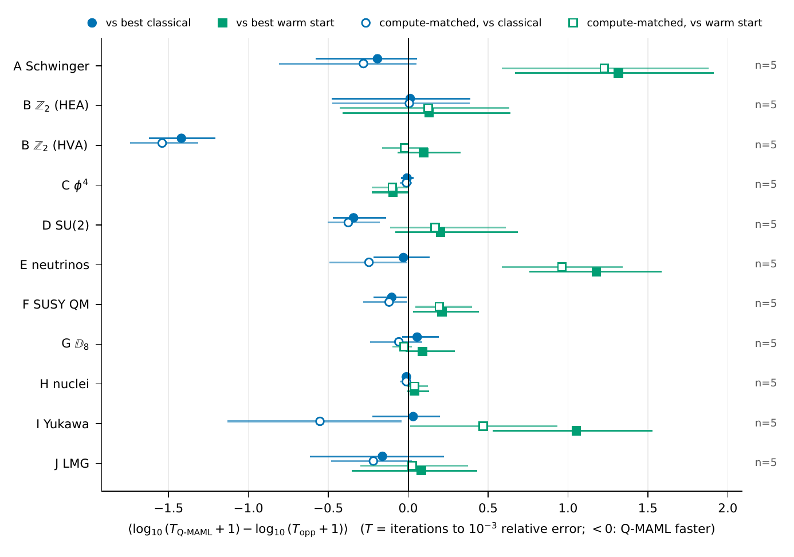
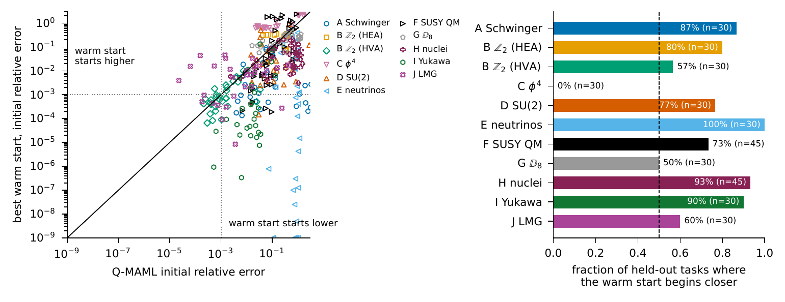
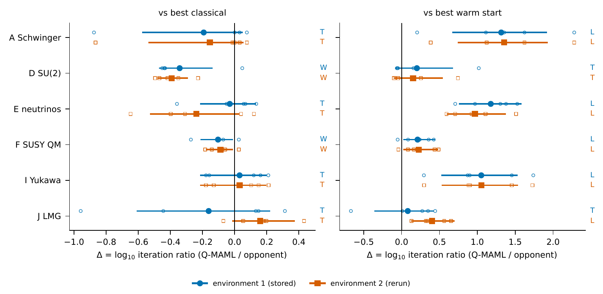
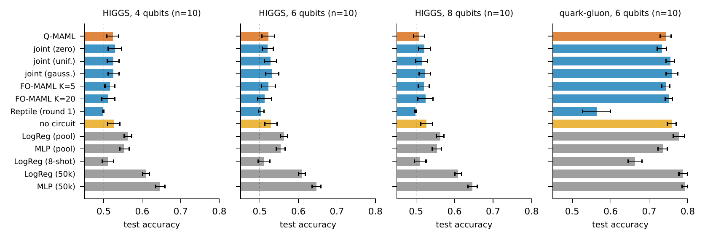

# Results

All numbers below come from `results/` through `qmaml-score` and `scripts/`. Nothing is typed by hand.

## Q-MAML against both families

Mean Δ = log₁₀(T_Q-MAML + 1) − log₁₀(T_opp + 1) per held-out task, with 95% hierarchical-bootstrap intervals
(5 seeds × 6–9 tasks). Negative means Q-MAML is faster.

| Track | System | Qubits | vs best classical | vs best warm start |
|---|---|:-:|---|---|
| A | Schwinger model, L = 2 | 4 | tie | **loss**\* (nearest) |
| B | Z₂ LGT, penalty HEA | 8 | tie† | tie† |
| B | Z₂ LGT, gauge-invariant HVA | 8 | **win**\* (uniform) | tie |
| C | φ⁴ scalar field | 6 | tie† | win† (mean) |
| D | SU(2) LGT, N = 2 | 4 | win (uniform; Holm p = 0.055) | tie |
| E | Collective neutrinos, N = 4 | 4 | tie | **loss**\* (nearest) |
| F | Supersymmetric QM | 4 | win (uniform) | loss (nearest) |
| G | D₈ LGT | 7 | tie† | tie† |
| H | Light nuclei (UCCSD) | 8 | tie | tie |
| I | Scalar Yukawa | 4 | tie | **loss**\* (kernel) |
| J | LMG, J = 3/2 | 2 | tie | tie |

\* Holm-corrected p < 0.05. † No initializer reaches 10⁻³, so the track is scored on final error and says nothing
about initialization.

## Why: where each method starts

On nine of eleven configurations, the best warm start begins closer to the ground state than Q-MAML on most
held-out tasks. For neutrinos that's every task, often by orders of magnitude. The Learner approximates the map
from Hamiltonian parameters to good angles, and the stored optima of solved neighbours approximate it better.

## Reproducibility across numerical environments

The study reran Q-MAML on six systems × five seeds in a second environment: same CPU, different OS, PyTorch build
and thread count. 11 of 12 verdicts are unchanged. One flips: LMG against the warm start goes from a tie to a loss.
Per-seed results move by up to 10×. See [Reproducibility](reproducibility.md).

## Classification

Q-MAML is statistically indistinguishable from the same pipeline without a Learner, from first-order MAML and from
a circuit-free head. Logistic regression on the same pooled events is better.

## Full tables

The LaTeX tables in [`figures/tables`](https://github.com/arnavk23/qmaml-hep/tree/main/figures/tables) cover the
extrapolation split, compute-matched Q-MAML, break-even task counts and per-system design.
